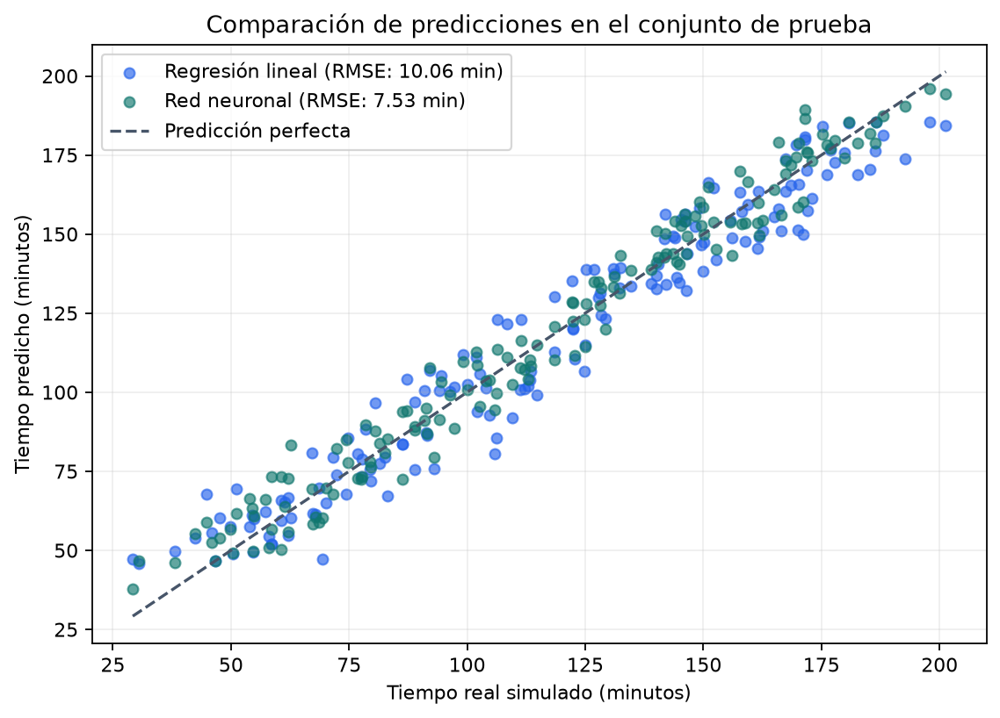

# RutaSegura & Predict
## Informe breve y guía para la exposición

**Fecha:** 20/11/2026

## 1. Objetivo

El proyecto es un prototipo para organizar una ruta de reparto y estimar su duración. Primero verifica el rostro del repartidor; después permite ingresar entre cinco y diez direcciones, ver el recorrido en un mapa, calcular estadísticas y comparar una regresión lineal simple con una red neuronal.

## 2. Cómo funciona la aplicación

1. **Portada de acceso:** el usuario elige entre iniciar sesión como repartidor existente o registrar un perfil nuevo.
2. **Registro facial:** el repartidor nuevo escribe su nombre y registra tres fotos con la cámara o selecciona fotos desde archivos. Al terminar, pasa a la pantalla de inicio de sesión.
3. **Inicio de sesión:** se selecciona un perfil existente y se toma otra foto. OpenCV detecta el rostro, lo convierte a escala de grises y mejora el contraste. El reconocedor LBPH compara esa imagen con las fotos registradas. Solo después de validar se abre la gestión de rutas.
4. **Direcciones y mapa:** Nominatim convierte las direcciones en coordenadas y OSRM busca un orden de visita y dibuja el recorrido por carretera. El primer y último punto ingresados quedan como origen y destino del cálculo. El servicio ofrece una optimización aproximada; no garantiza el óptimo global ni conoce necesariamente el tráfico actual.
5. **Estadísticas:** la aplicación calcula distancia total por carretera, promedio y variación de las distancias entre tramos, y dispersión geográfica de las paradas.
6. **Predicción:** se ingresan la distancia y las estadísticas de la ruta, junto con la hora de salida y un nivel de tráfico elegido por el usuario. La aplicación muestra las predicciones y compara los modelos con un conjunto de prueba.

### Código que implementa el análisis

| Archivo o función | Responsabilidad |
|---|---|
| `app.py` — `extraer_estadisticas_ruta` | Obtiene la distancia total de OSRM, el promedio y la desviación estándar de los tramos, la cantidad de paradas y la dispersión geográfica. |
| `app.py` — `calcular_dispersion_km` | Convierte diferencias aproximadas de latitud/longitud a kilómetros y calcula la distancia RMS de las paradas al centro geográfico. |
| `modelo.py` — `crear_historial_sintetico` | Genera el conjunto artificial y reproducible de rutas; la variable objetivo es el tiempo simulado en minutos. |
| `modelo.py` — `entrenar_y_evaluar` | Divide los datos, prepara la matriz de características, entrena ambos modelos y devuelve MSE, RMSE, R² y predicciones de prueba. |
| `app.py` — pestaña **Análisis del proyecto** | Presenta la tabla de métricas y el gráfico comparativo creado con Matplotlib. |

## 3. Datos y preparación

No se proporcionó un historial real de entregas. Por eso el prototipo crea **800 ejemplos sintéticos** y reproducibles; son datos artificiales, no registros de una empresa. Cada ejemplo incluye:

- distancia total en kilómetros;
- promedio y variación de distancia entre tramos;
- dispersión geográfica;
- cantidad de paradas;
- hora de salida;
- nivel de tráfico simulado;
- tiempo total simulado en minutos, que es la variable que se predice.

La función `train_test_split` separa los ejemplos: 80 % para entrenamiento y 20 % para prueba. El escalador `StandardScaler` aprende los promedios y desviaciones del conjunto de entrenamiento y aplica esa normalización a las entradas de la red. Así se evita usar información del conjunto de prueba durante el ajuste.

Las estadísticas de la ruta ingresada sí se calculan a partir de sus coordenadas y distancias. El conjunto sintético permite demostrar el flujo de entrenamiento cuando no hay datos históricos, pero no permite afirmar que las predicciones sean precisas para una operación real. Para producción se necesitarían tiempos reales de salida y llegada, distancias, cantidad de paradas, zona, horario y tráfico.

## 4. Modelos y estructura de la red neuronal

### Regresión lineal simple

Se entrena una regresión lineal usando solamente la distancia total como entrada y el tiempo en minutos como salida. El modelo aprende una relación aproximada de la forma:

`tiempo estimado = pendiente × distancia + intercepto`

Es un modelo sencillo que sirve como referencia, pero no considera directamente el tráfico, la hora ni la cantidad de paradas.

### Red neuronal con TensorFlow/Keras

Cada ruta se representa con un vector de **siete características**. Al reunir muchos ejemplos se forma una matriz: cada fila representa una ruta y cada columna una característica. La red contiene una capa de entrada, capas densas de 32 y 16 neuronas con activación ReLU, y una salida de un valor: los minutos estimados.

Las capas densas multiplican las entradas por pesos y suman sesgos. Durante el entrenamiento, Keras ajusta esos valores para reducir el error cuadrático medio. ReLU permite modelar relaciones no lineales al transformar los valores negativos de una neurona en cero. La salida final no usa una clasificación: predice un número continuo de minutos.

La matriz de entrada tiene forma `n × 7`: `n` rutas y siete variables por ruta. La salida es un vector de `n` tiempos. En cada predicción de una ruta real se construye una fila con esas mismas siete columnas y se normaliza con el escalador entrenado.

## 5. Evaluación observada

En una ejecución del prototipo con los datos sintéticos se obtuvieron estos resultados:

| Modelo | MSE | RMSE (minutos) | R² |
|---|---:|---:|---:|
| Regresión lineal | 101.284 | 10.064 | 0.946 |
| Red neuronal | 56.767 | 7.534 | 0.970 |

- **MSE:** `Σ(real − predicción)² / n`. Promedia los errores al cuadrado, penaliza más los errores grandes y se expresa en minutos cuadrados.
- **RMSE:** `√MSE`. Se expresa en minutos y representa el tamaño típico del error; menor es mejor.
- **R²:** `1 − Σ(real − predicción)² / Σ(real − promedio_real)²`. Indica qué proporción de la variación explica el modelo; suele ser mejor cuanto más se acerca a 1 y puede ser negativo.

**Conclusión técnica:** con este conjunto sintético, la red neuronal tuvo menor MSE y RMSE y mayor R² que la regresión lineal. Por eso conviene más **para esta demostración**. No se debe concluir que será mejor con repartos reales: habría que entrenar y evaluar ambos modelos con datos reales y representativos.

El gráfico usa las mismas rutas de prueba para ambos modelos. La línea diagonal representa una predicción perfecta; cuanto más cerca quedan los puntos, menor es la diferencia visual.

## 6. Limitaciones, seguridad y privacidad

- El reconocimiento facial con LBPH es educativo: puede fallar con poca luz, movimiento o cambios de apariencia, y no incluye prueba de vida. No es adecuado para controlar accesos reales.
- Los perfiles y modelos faciales solo duran la sesión actual; el prototipo no los guarda en una base de datos. Para iniciar sesión después de cerrar la pestaña o reiniciar la aplicación, se debe volver a registrar el perfil.
- El historial es sintético; las estimaciones no deben usarse para prometer horarios de entrega.
- Las direcciones se envían a Nominatim y las coordenadas a OSRM para crear el mapa. Los enlaces de navegación abren Google Maps. Se deben usar direcciones de demostración y avisar al usuario.
- La aplicación debe prepararse con el vehículo estacionado. El teléfono debe ir en un soporte fijo, sin bloquear la vista ni los airbags; la navegación por voz se inicia antes de arrancar. Nunca se debe tocar o mirar la pantalla mientras se conduce.
- `localhost:8501` sirve para la demostración en la computadora que ejecuta la app. Abrirla desde un teléfono requiere publicarla de forma segura; no se debe desplegar este prototipo biométrico tal cual.

## 7. Guion sugerido para una exposición de 3 a 4 minutos

Adapta este texto a tu forma de hablar y practica explicando los conceptos sin leerlo palabra por palabra:

> Buenos días. Mi proyecto se llama RutaSegura & Predict. Busca demostrar cómo se puede verificar la identidad de un repartidor, ordenar varias paradas y estimar el tiempo de una ruta.
>
> Al ingresar, se puede elegir iniciar sesión o registrar un repartidor nuevo. Para el registro se guardan tres fotos en memoria y después se valida el rostro con una foto adicional antes de entrar. Para iniciar sesión en esta misma sesión, un repartidor ya registrado solo selecciona su perfil y valida su rostro. Usé OpenCV y el método LBPH para comparar las imágenes. Es una demostración académica, no un sistema biométrico de producción.
>
> Después se ingresan al menos cinco direcciones. Nominatim las convierte en coordenadas y OSRM propone un orden y un recorrido por carretera. También calculo la distancia total, el promedio y la variación de los tramos y la dispersión de las paradas.
>
> Para la predicción no recibí un historial real, así que construí 800 ejemplos sintéticos. Separé los datos en entrenamiento y prueba. Comparé una regresión lineal que usa solo la distancia con una red neuronal de siete características. En una ejecución, la red obtuvo RMSE de aproximadamente 7.53 minutos y la regresión 10.06 minutos. Por eso la red fue mejor en esta prueba, aunque el resultado no se puede generalizar a repartos reales.
>
> En conclusión, el prototipo integra mapa, estadísticas y comparación de modelos. El siguiente paso sería reemplazar los datos sintéticos por registros reales y volver a evaluar los modelos. Gracias.

## 8. Orden recomendado para la demostración

1. Explicar que es un prototipo académico y que el historial es sintético.
2. En la portada, mostrar las opciones **Iniciar sesión** y **Registrarme**.
3. Registrar un repartidor con tres fotos propias, con buena iluminación, o usar fotos de prueba con autorización.
4. Validar el rostro con una foto adicional para ingresar; después cerrar sesión y mostrar que un usuario existente solo necesita validar su rostro.
5. Ingresar cinco direcciones públicas de prueba de una misma ciudad y aceptar el envío a los servicios de mapas.
6. Mostrar el mapa, el orden de las paradas y las estadísticas.
7. Abrir la pestaña **Análisis del proyecto** y explicar la tabla de métricas y el gráfico.
8. Concluir qué modelo rindió mejor en los datos sintéticos y qué se necesitaría para validarlo en la operación real.

## 9. Lista antes de entregar

- [ ] Completar nombre, curso y fecha.
- [ ] Ejecutar la aplicación desde el entorno virtual y comprobar el acceso facial.
- [ ] Probar una ruta con cinco direcciones válidas, con conexión a Internet.
- [ ] Tomar capturas propias del mapa y de la tabla/gráfico de modelos.
- [ ] Revisar que se entiende la diferencia entre datos sintéticos y datos reales.
- [ ] Practicar la explicación de MSE, RMSE, R², las siete entradas y ReLU.
- [ ] Entregar el código, `requirements.txt`, el README y este informe según las instrucciones de la plataforma del curso.
- [ ] Si el curso establece reglas sobre el uso de IA, cumplirlas y describir la asistencia recibida con honestidad.
